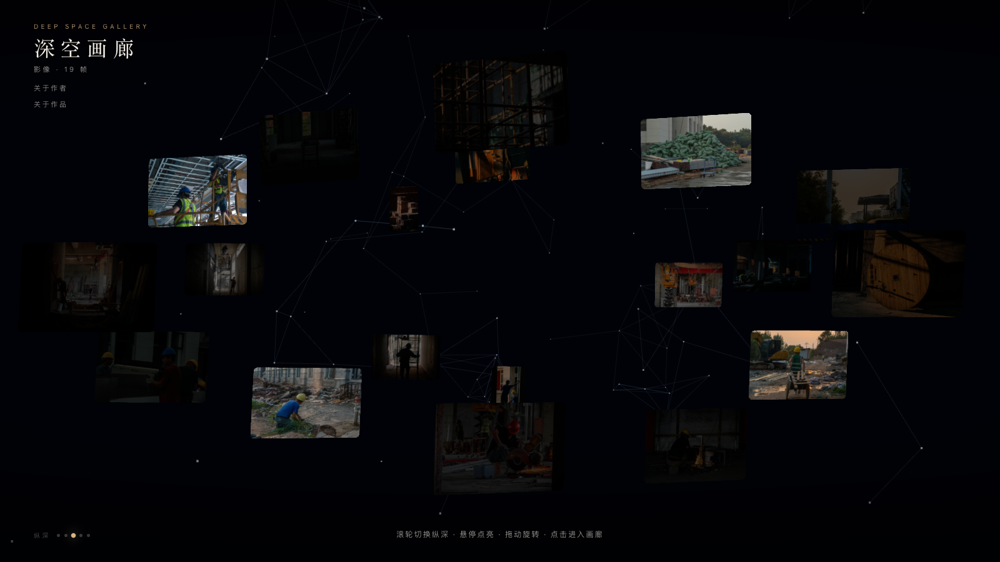
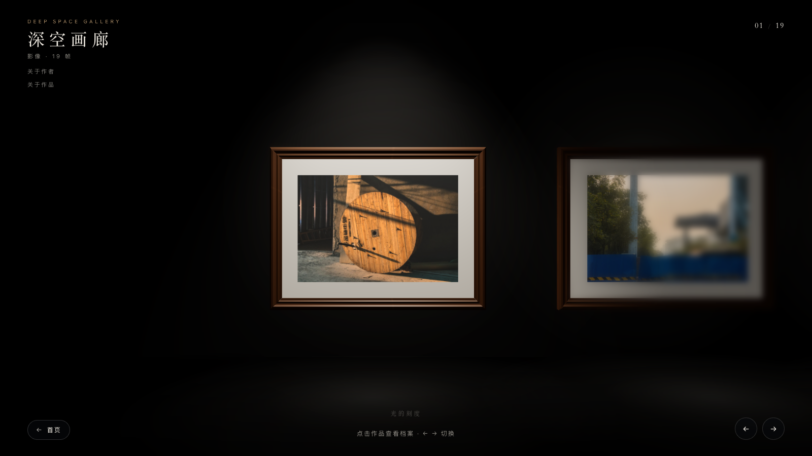
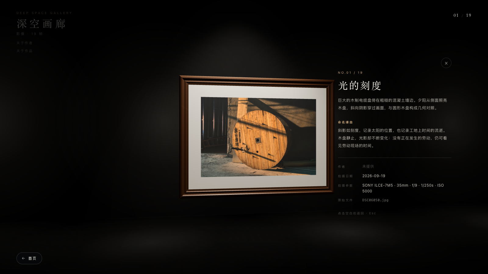
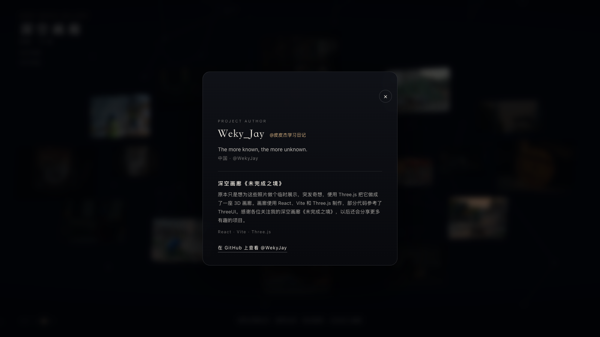
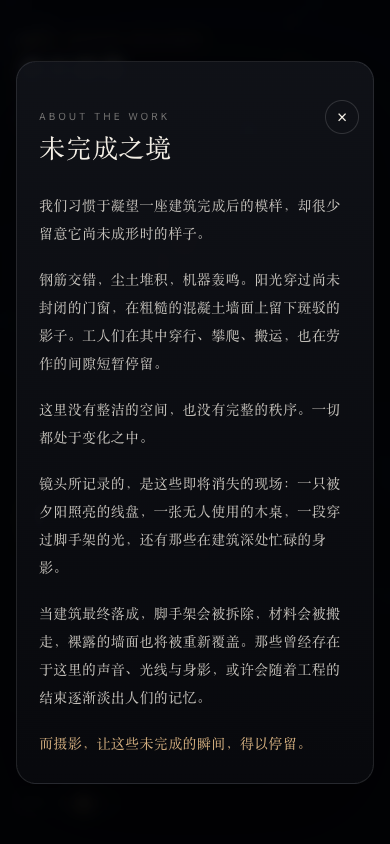

# 深空画廊 · Deep Space Gallery

一个沉浸式的三维摄影画廊：镜头从深空中的悬浮照片开始，滚轮切换纵深，
点击任意一幅后照片沿墙布展开，形成一条带聚光灯的长廊；再次点击作品，
其余照片退场，作品移到左侧，右侧展开标题、简介、作者与拍摄参数。
长廊可以随时按「首页」回到深空；页首「关于作者」与「关于作品」分别介绍创作者和摄影主题。

**在线体验：** [深空画廊《未完成之境》](https://wekyjay.github.io/deep-space-gallery/)

## 画廊预览



| 画廊长廊 | 作品档案 |
| --- | --- |
|  |  |

| 作者介绍 | 关于作品 · 手机端 |
| --- | --- |
|  |  |

## 技术栈

- **React 19** — 界面与状态（加载进度、模式、当前作品、档案面板）
- **Three.js 0.187** — 场景、灯光、相框、粒子与纸张弯曲
- **Vite 8** — 开发服务器与打包

场景不依赖任何动画库：一个渲染循环、一个阻尼插值器和一个极简补间队列，
所有对象复用，不在帧循环中分配内存。

## 启动

```sh
npm install
npm run dev        # http://localhost:5173
```

生产构建与本地预览：

```sh
npm run build
npm run preview
```

## 操作

| 场景 | 操作 |
| --- | --- |
| 深空 | 滚轮切换纵深（底部圆点指示当前层）；悬停点亮照片，鼠标所在的角会像纸片一样朝观察者倾斜，并伴随轻微卷曲；按住拖动可转动照片，松手带惯性；点击进入画廊 |
| 画廊 | 悬停照片时轻微放大，鼠标所在的角朝观察者倾斜；点击打开档案；`←` `→` 或横向拖动切换作品；`Esc` 关闭档案；左下「首页」回到深空（手机端箭头位于作品两侧，竖图会自动拉近以完整呈现） |
| 档案 | 悬停作品时画框随鼠标位置倾斜；点击空白处或按 `Esc` 返回画廊 |
| 关于 | 页首「关于作者」打开创作者与项目介绍，「关于作品」打开摄影主题文字；`Esc` 或点击遮罩关闭 |

深链接：`#/gallery` 直接进入长廊，`#/photo/3` 进入长廊并展开第 3 幅作品。

## 目录

```
index.html                 入口，挂载 #root
src/main.jsx               React 根
src/App.jsx                界面层：加载、提示、计数器、档案面板、关于弹层
src/data/author.js         作者与作品介绍文案
src/styles/gallery.css     排版、景深模糊遮罩、响应式
src/scene/engine.js        渲染器、相机、交互、补间与生命周期
src/scene/photos.js        照片平面、圆角卡片、纸张弯曲着色器、纵深布局；
                           深空与墙上各用一份材质，避免调暗状态串到画廊
src/scene/seigaiha.js      原创程序化木质相框（阶梯式倒角与斜接）
src/scene/environment.js   墙面、地面、聚光灯与光晕
src/scene/particles.js     星座粒子网络
src/scene/data.js          照片清单与元数据
src/scene/config.js        统一可调参数
scripts/make_thumbs.py     从压缩素材生成缩略图与清单
scripts/import_exif.py     从另存的原图只读导入拍摄参数
scripts/dev-shot.mjs       无头 Chrome 截图（本地视觉检查）
public/assets/thumbs/      19 张最长边不超过 1600px 的缩略图 + manifest.json + artworks.json（Vite 静态资源）
素材/                       压缩素材（不参与构建）
docs/screenshots/           项目界面实拍截图
.github/workflows/pages.yml 推送 main 后自动构建和发布 GitHub Pages
```

## 图片与元数据

压缩素材放在 `素材/`，重新生成缩略图和清单：

```sh
python3 -m pip install pillow
python3 scripts/make_thumbs.py
```

脚本会读取 `素材/` 的 EXIF，把拍摄日期、机身、光圈、快门、ISO、焦距写进
`public/assets/thumbs/manifest.json`，档案面板便可显示真实的拍摄参数。
如果画廊使用压缩照片、而拍摄参数只保留在别处的原图中，可单独导入 EXIF：

```sh
python3 scripts/import_exif.py --src /path/to/originals
```

导入器按原始文件名逐一核对，仅读取原图并更新现有 `manifest.json` 的拍摄字段；
不会复制原图、重做缩略图或改动作品标题与陈列顺序。此操作应在运行
`make_thumbs.py` 之后执行，因为重新生成缩略图会重新生成清单。

当前组照收录 19 张施工现场摄影作品。`public/assets/thumbs/artworks.json` 用原始
文件名作为 `artworks` 的键，分别保存标题、画面解读与命名缘由；`order` 数组决定
画廊导航和五层纵深里的排列顺序。首幅《光的刻度》与末幅《光在尽头》的木盘、
夕阳彼此呼应；《围挡之外》紧随首幅，引出围挡以内的场景。其余作品由材料与
空间过渡至施工者、协作和黄昏。

例如：

```json
{
  "order": ["DSC06050.jpg", "DSC06026.jpg", "…其他同名照片…"],
  "artworks": {
    "DSC06050.jpg": {
      "title": "光的刻度",
      "description": "木制电缆盘与夕阳下的斜影形成几何对照。",
      "rationale": "斜影如刻度，记录工地上时间的流逝。"
    }
  }
}
```

实际配置中的 `order` 与 `artworks` 必须恰好列出 `素材/` 下的全部照片，生成器会
检查缺漏、重名与多余的文件名，防止缩略图改序后标题错配。档案中的作者仅在逐幅
作品明确提供时显示，EXIF 缺项显示「未提供」。

## GitHub Pages 自动发布

推送到公开仓库的 `main` 分支会触发 [Pages 工作流](.github/workflows/pages.yml)：
Node.js 24 下运行 `npm ci`，以 `GITHUB_PAGES=true` 构建 `/deep-space-gallery/` 子路径，
上传 `dist/` 并部署。仓库设置 **Settings → Pages → Build and deployment → Source**
需选择 **GitHub Actions**。图片只使用 `public/assets/thumbs/` 中的压缩缩略图；
`素材/` 和另存的原图不参与网站部署。首次部署成功后访问
<https://wekyjay.github.io/deep-space-gallery/>。

## 性能取舍

- 单一 `WebGLRenderer` 与 `setAnimationLoop`，每帧只渲染一次。
- 像素比上限 1.75，并按帧时间在 1.0–1.75 之间自适应升降。
- 粒子只更新位置与连线，且限制在 30Hz；连线数量按每颗粒子最多 4 条预分配。
- 景深模糊用 CSS `backdrop-filter` + 径向遮罩实现，由合成器处理，
  不再逐帧回读 WebGL 画布（旧实现的卡顿来源）。
- 照片的纸张弯曲在顶点着色器里完成，CPU 每帧只写 2 个 uniform。
- 非当前纵深的照片用自发光强度区分，不切换 `transparent`，避免材质重编译。
- 切换作品时统一重置 `visible / scale / position`，杜绝「照片消失」。
